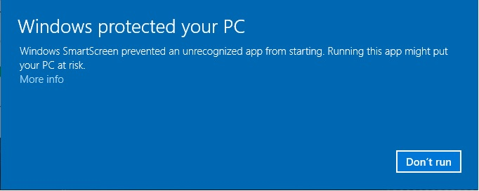

# OAUTHC Cholecystectomy Shared Annotation Study

## Please begin here

Thank you for helping with this surgical-video annotation study. This is the first shared stage of the wider OAUTHC cholecystectomy annotation work.

Both annotators should independently annotate the same five videos in this package. The purpose is to measure **inter-rater variability**: where two informed annotators place the same labels and boundaries similarly, and where the written rules may still require clarification.

This is not a test of either annotator. Differences are useful evidence for improving the annotation protocol.

## Package contents

- `01_Application`: Phase Annotator 0.1.2 for Windows.
- `02_User_Guide`: instructions for installing and using the application.
- `03_Cholec80_Training_Material`: the original draft protocol and transition-centred Cholec80 example clips used for the first clinician review.
- `04_Shared_Study_Videos`: the five videos that both annotators should complete independently.
- `05_Return_Annotations_Here`: place the five completed JSON annotation files here before returning the folder.

## Before annotating

1. Read the user guide.
2. Read `03_Cholec80_Training_Material/Draft_Annotation_Protocol.pdf`.
3. Open `03_Cholec80_Training_Material/OPEN_CLIP_LIBRARY.html` and review the transition examples.
4. Run `01_Application/PhaseAnnotator.exe`.
5. Enter only your first name when asked for the annotator identity.
6. Select **Laparoscopic Cholecystectomy**.

Windows may initially display an “unknown publisher” warning because this research build is not commercially code-signed. Select **More info**, confirm that the application is `PhaseAnnotator.exe`, and select **Run anyway**.

## Annotating each video

1. Open one video from `04_Shared_Study_Videos`.
2. Annotate the complete available recording using the supplied draft protocol and transition examples.
3. Use segment notes for important uncertainty, prolonged inactive periods, or an unusual event. Do not include patient-identifying information.
4. Review the entire phase timeline.
5. Mark the annotation **Completed**.
6. Confirm that a file ending in `.phase-annotations.json` is beside the video.
7. Copy that JSON file into `05_Return_Annotations_Here`.

Do not copy or rename another annotator’s JSON file as your own. Work independently for these first five cases; comparison and discussion occur after both sets are returned.

## Important annotation rules

- Follow the supplied draft protocol consistently. The example library shows the transition boundaries used in the Cholec80 reference annotations.
- A phase describes the dominant visible operative activity over time; use the protocol's operational boundary cues when deciding exactly where a transition occurs.
- If the operative context remains clear during a pause, continue the current phase.
- For a notable prolonged inactive period, retain the timeline and add a short note.
- Use **Undefined** when the visible activity genuinely cannot be assigned confidently, including unclassifiable or out-of-body footage.
- Do not delete portions of the recording or alter the source video.

## Returning the work

Return the five completed JSON files after this shared stage. Tosin will check that they load correctly and compare agreement before the next videos are divided between annotators.

The wider collection contains 26 videos. After the shared five are reviewed, the remaining work will be distributed in manageable batches and checked between returns.

If anything goes wrong, please stop and message Tosin rather than recreating or editing a JSON file manually.
